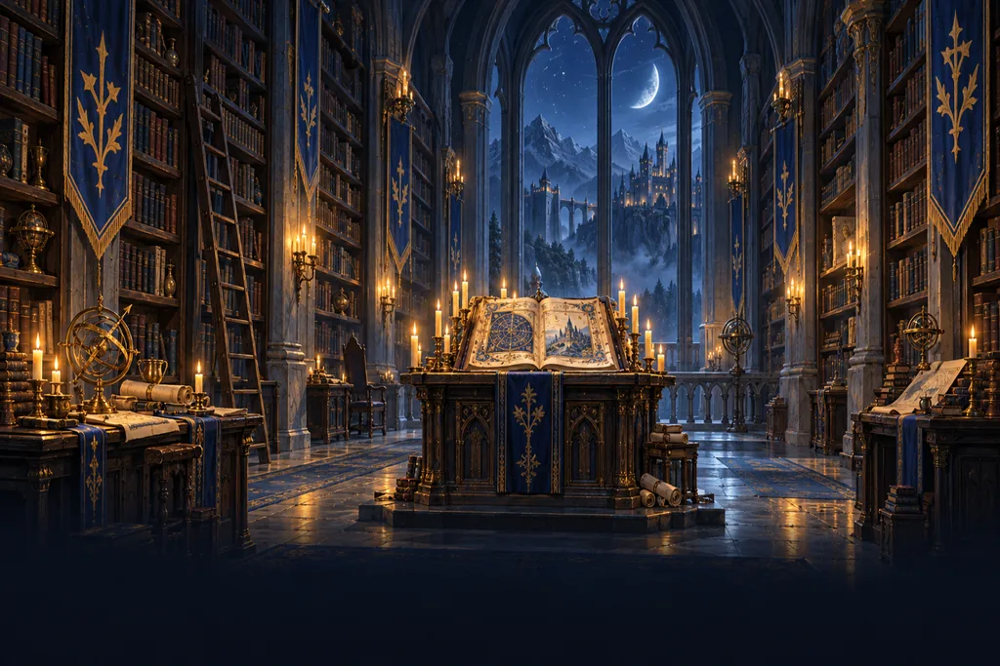

# SideQuest handbook

<div class="sq-hero">
<picture>
  <source type="image/avif" srcset="_static/art/library-480.avif 480w, _static/art/library-768.avif 768w, _static/art/library-1024.avif 1024w, _static/art/library-1536.avif 1536w" sizes="100vw">
  <source type="image/webp" srcset="_static/art/library-480.webp 480w, _static/art/library-768.webp 768w, _static/art/library-1024.webp 1024w, _static/art/library-1536.webp 1536w" sizes="100vw">
  
</picture>
<div class="sq-hero-content">
<p class="sq-hero-eyebrow" aria-hidden="true">The library of the citadel</p>
<p class="sq-hero-title" aria-hidden="true">SideQuest handbook</p>
<p class="sq-hero-lede">How to join the guild, raid with it, run it, and build the apps behind it.</p>
<form class="sq-hero-search" action="search.html" method="get" role="search">
<input type="search" name="q" aria-label="Search the handbook" placeholder="Search the handbook">
</form>
</div>
</div>

SideQuest is an Alliance guild on World of Warcraft: Forever. Pick the door that fits you.

::::{grid} 1 2 4 4
:gutter: 3
:class-container: sq-doors

:::{grid-item-card} Join the guild
:link: members/join
:link-type: doc
:class-card: sq-door

Sign in, link Battle.net, and get your roles in Discord.
:::

:::{grid-item-card} Raid nights
:link: members/events
:link-type: doc
:class-card: sq-door

Sign up for events, use the addon, and read your points.
:::

:::{grid-item-card} Officers' handbook
:link: officers/index
:link-type: doc
:class-card: sq-door

Run events and raid nights, mark attendance, and confirm members.
:::

:::{grid-item-card} Build with us
:link: developers/index
:link-type: doc
:class-card: sq-door

Run, test, and change the four apps.
:::
::::

## The four apps

::::{grid} 1 1 2 2
:gutter: 3
:class-container: sq-apps

:::{grid-item-card} Website and API
:class-card: sq-app

The site at sidequest-guild.com and the API behind it.

{doc}`Guide <developers/website/index>` · {doc}`Reference <reference/website/index>` ·
{doc}`Changelog <changelog/website>` · [Repo](https://github.com/SideQuest-Guild/website)
:::

:::{grid-item-card} Discord bot
:class-card: sq-app

Game Master: event posts, sign-up buttons, roles, badges, and moderation.

{doc}`Guide <developers/bot/index>` · {doc}`Reference <reference/bot/index>` ·
{doc}`Changelog <changelog/bot>` · [Repo](https://github.com/SideQuest-Guild/bot)
:::

:::{grid-item-card} Addon
:class-card: sq-app

The in-game window for the roster, raid sign-ups, loot points, and raid nights.

{doc}`Guide <developers/addon/index>` · {doc}`Reference <reference/addon/index>` ·
{doc}`Changelog <changelog/addon>` · [Repo](https://github.com/SideQuest-Guild/addon)
:::

:::{grid-item-card} Companion
:class-card: sq-app

A tray app for Windows, macOS, and Linux that syncs the addon with the site.

{doc}`Guide <developers/companion/index>` · {doc}`Reference <reference/companion/index>` ·
{doc}`Changelog <changelog/companion>` · [Repo](https://github.com/SideQuest-Guild/companion)
:::
::::

```{toctree}
:maxdepth: 2
:hidden:

members/index
officers/index
developers/index
reference/index
changelog/index
contributing/index
```
